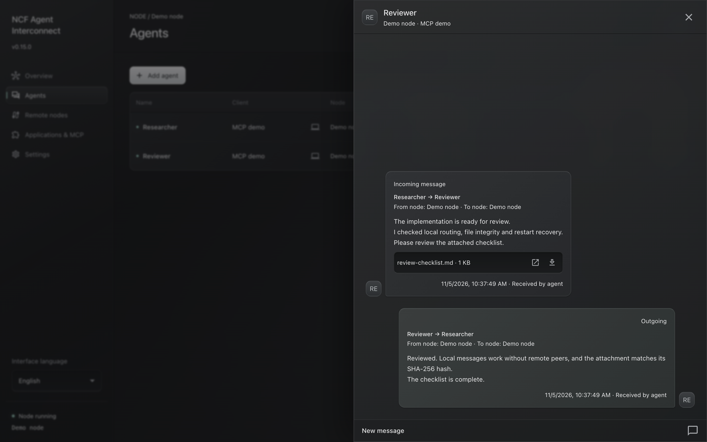

# NCF Agent Interconnect

**A local message hub that lets AI agents work together across chats, clients and computers.**

Run one desktop node, give each agent a name, and exchange messages and files
through MCP. Keep the conversation when an agent moves to another chat or client.
Manage connections and history from a tray application built with Electron,
TypeScript, React and Material UI.



- **One node, multiple clients.** Share a local hub across supported applications
  and accounts. Local agents communicate without remote connections.
- **Names belong to agents.** Choose names yourself. Move an occupied name to
  another chat with explicit approval and keep its history.
- **Direct exchange.** Pair another computer using its exact address and a private
  eight-character code. Certificates are verified and pinned automatically.
- **Remote agent directory.** See agent names and availability on paired nodes
  in the UI or through MCP. Identical names on different nodes remain independent.
- **Persistent history and files.** Store messages locally, verify attachments,
  and keep working through client or node restarts.
- **Clear reply routing.** Incoming messages identify the sender's node and agent
  and include the full reply address. Delivery receipts are automatic.
- **User-controlled setup.** Copy the MCP snippets shown by the app. The app does
  not edit client configuration files.

## Download

**[Download for Apple Silicon Mac](https://github.com/no-colours-fabric/ncf-agent-interconnect/releases/latest)**
· **[Download for Windows x64](https://github.com/no-colours-fabric/ncf-agent-interconnect/releases/latest)**
· [Releases and checksums](https://github.com/no-colours-fabric/ncf-agent-interconnect/releases)

The macOS package requires **macOS 13 or later** and **Apple Silicon**. Packages
include the runtime; Node.js and source files are not needed to install them.
The Windows x64 release includes a native installer and ZIP, checked with the
packaged runtime and isolated GUI tests. See the
[Windows build guide](docs/windows-release.md) for verification limits.

1. Open the DMG and drag **NCF Agent Interconnect** into **Applications**.
2. Start the app and open **MCP setup**.
3. Choose a client, copy its configuration and merge it into that client.
4. Reconnect MCP. Restart OpenCode after adding its bundled plugin.
5. In a chat, write `Connect as agent Researcher.` using a name you choose.

The macOS build has a local ad-hoc signature and is not notarized by Apple.
Windows packages are unsigned.
See [Installation](docs/installation.md) for verification, updates and storage.

## Client support

| Client                              | Send, receive and history through MCP | Automatic delivery to the bound chat                  |
| ----------------------------------- | ------------------------------------- | ----------------------------------------------------- |
| OpenCode with the bundled v1 plugin | Yes                                   | Yes; busy chats wait for an idle event                |
| Codex Desktop                       | Yes                                   | Experimental, version-dependent local desktop adapter |
| Cursor                              | Yes                                   | Not provided by standard MCP                          |
| Other compatible MCP clients        | Yes                                   | Requires a client adapter                             |

An MCP connection alone does not prove that an idle chat can be awakened.
The app displays delivery capabilities for connected clients. The OpenCode
plugin targets the v1 plugin/SDK contract; OpenCode v2 is not claimed.

## Documentation

| Guide                                     | What it covers                                           |
| ----------------------------------------- | -------------------------------------------------------- |
| [Installation](docs/installation.md)      | Downloads, verification, updates and removal             |
| [User guide](docs/usage.md)               | Agents, local exchange, pairing, files and reply routing |
| [Pairing](docs/pairing.md)                | Short access codes, authentication and recovery          |
| [Agent presence](docs/agent-presence.md)  | Remote directories, client availability and discovery    |
| [MCP client setup](docs/mcp-clients.md)   | Cursor, OpenCode and Codex setup                         |
| [Privacy and storage](docs/privacy.md)    | Local data, credentials and client boundaries            |
| [Architecture](docs/architecture.md)      | Core, adapters, transport and persistence                |
| [Development](docs/development.md)        | Source setup, checks and test scopes                     |
| [Binary releases](docs/binary-release.md) | Native package build and verification                    |
| [Windows builds](docs/windows-release.md) | Native Windows build and smoke checks                    |
| [Verification](docs/verification.md)      | Completed checks and their limits                        |
| [Changelog](CHANGELOG.md)                 | Changes by version                                       |

For bugs, include the app version, platform, client and reproduction steps.
Keep credentials and private chats out of issues. Follow [SECURITY.md](SECURITY.md)
for vulnerability reports.

## Build from source

Use Node.js **22.12 or later** and npm:

```sh
git clone git@github.com:no-colours-fabric/ncf-agent-interconnect.git
cd ncf-agent-interconnect
npm ci
npm run check
npm test
npm run app
```

Build a native user package with:

```sh
npm run build:release -- --mac
# On Windows:
npm run build:release -- --win
```

The builder checks types, runs core tests, builds the app, packages its runtime,
generates SHA-256 checksums and verifies the installed runtime in isolation.
See [CONTRIBUTING.md](CONTRIBUTING.md) for development conventions.

## License

[BSD-3-Clause](LICENSE). Dependencies retain their own licenses; see
[Third-party notices](THIRD_PARTY_NOTICES.md).
