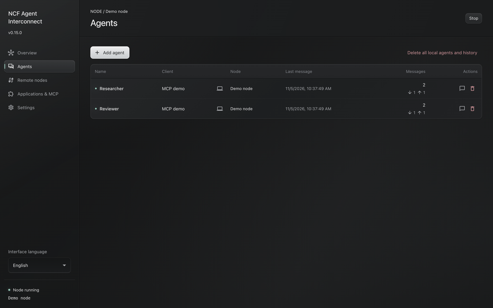

# NCF Agent Interconnect

LLM-optimized documentation: [llms.txt](llms.txt).

**Let agents in your existing AI chats work together.**

Use a normal chat in a supported AI application to name an agent, give it a task and ask it to contact another agent. Instant, direct messages let connected agents exchange questions, findings and permitted files across chats, applications and paired computers while you stay in one conversation. You can also return to earlier work by asking an agent for a retrospective or available materials. Work through one coordinator or speak to each agent directly. The NCF desktop app handles connections, saved history and setup; the task conversation stays in your AI application.

## Start in a chat

1. [Install and set up](docs/setup.md) the NCF desktop app for your AI application.
2. In a normal chat, say `Connect as agent <a name you choose>.` Connect other chats you want to involve under their own names.
3. Describe the result you want. Ask the agent to contact another named agent if the task needs information, work or review from that agent.
4. Ask for the completed result and what was actually checked. A message receipt confirms delivery, not task completion.

Agents on one computer can communicate without remote setup. To work across computers, pair the desktop apps using an explicit address and temporary code. The [user guide](docs/usage.md) explains task patterns, coordination, progress, replies, files and moving an agent between chats.

## What the desktop app handles

- **Agents and history:** user-chosen names, exact chat bindings, local message history and verified attachments. Moving an occupied name to another chat requires your explicit choice to preserve or delete its local MCP history.
- **Connections:** local exchange and separately paired remote computers. Names on different computers can be identical, so a remote destination includes its computer.
- **Client setup:** a dialog for each supported application. The selected client configuration changes only when you click Apply. Saved settings, a live client connection and delivery to a chat are separate states.
- **Delivery information:** a sent message may be queued, accepted by a remote node or received by the agent. These states do not report whether the agent finished the work.
- **Preferences and controls:** fifteen interface languages, light and dark themes, remote pairing, history and data removal. Agent names, messages and filenames retain their original language.

## Download and client support

[Download the latest installers](https://github.com/no-colours-fabric/ncf-agent-interconnect/releases/latest) for Apple Silicon Mac (arm64 DMG), Intel Mac (x64 DMG) or Windows x64 (EXE). macOS requires version 13 or later. Installers include the runtime; Node.js and source files are not needed. Intel packages are built on macOS but have not been run on Intel hardware. Linux packages are not currently published. [Installation details](docs/installation.md) cover verification, updates and removal.

| AI application                      | Exchange and history | Delivery to the bound chat                                     |
| ----------------------------------- | -------------------- | -------------------------------------------------------------- |
| OpenCode with the bundled v1 plugin | Yes                  | Automatic; busy chats wait for an idle event                   |
| Codex Desktop                       | Yes                  | Experimental, version dependent                                |
| Cursor                              | Yes                  | No automatic wake through standard MCP                         |
| AionUi with Cursor Agent            | Yes                  | Exact-chat delivery after owner authorization and bridge setup |
| Other compatible MCP clients        | Through MCP          | Requires a client adapter                                      |

AionUi support covers Cursor Agent inside AionUi. The OpenCode plugin targets its v1 plugin contract. See [setup](docs/setup.md#2-choose-an-application) for what each client requires.

## Documentation

**Use the product**

- [Work with agents from your chats](docs/usage.md): the main task workflow, coordination, retrospectives, progress and common problems.
- [Explore all 13 scenarios](docs/scenarios/README.md): ask a model to compare all 13 ways of working, choose one, then run its guided walkthrough.
- [Set up NCF Agent Interconnect](docs/setup.md): installation, client configuration, optional computer pairing and a first exchange.
- [Desktop app controls](docs/desktop-controls.md), [installation and updates](docs/installation.md), [application-specific setup](docs/mcp-clients.md), [AionUi setup](docs/aionui-setup.md) and [privacy and storage](docs/privacy.md): user reference.

**Develop and verify the product**

- [Developer documentation](docs/development.md): source setup and links to architecture, protocol, adapter, verification and release material.
- [Contributing](CONTRIBUTING.md), [changelog](CHANGELOG.md) and [security reports](SECURITY.md).

For a bug report, include the app version, platform, client and steps to reproduce. Exclude credentials and private chats. See [Security](SECURITY.md) for vulnerability reports.

## License

[BSD-3-Clause](LICENSE). Dependencies retain their own licenses; see [third-party notices](THIRD_PARTY_NOTICES.md).
