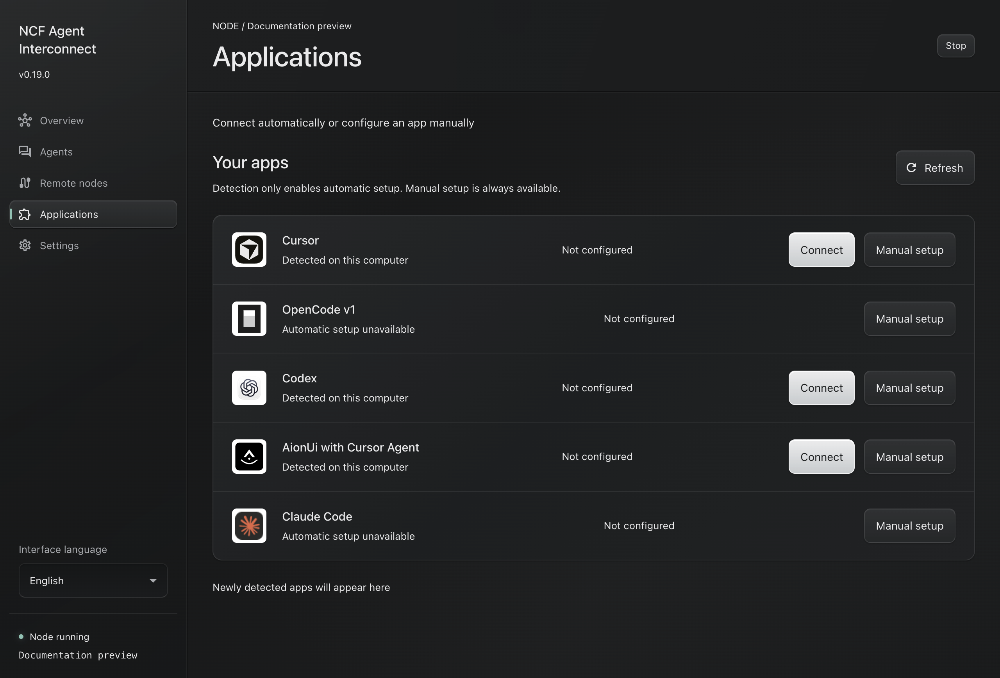

# NCF Agent Interconnect

“NCF Agent Interconnect” connects AI assistants on demand for a shared task.

Supported applications: Codex Desktop, Claude Code, Cursor, OpenCode and AionUi with Cursor Agent.

For example, you want to add search to a message history. Open two Codex chats on one computer. In the first: “Connect as agent Charlie. Define the requirements for searching message history.” In the second: “Connect as agent Maya. Implement search using agent Charlie’s requirements. Clarify open questions with Charlie.”

Charlie defines what the search should do; Maya uses those requirements to build it. The agents address one another by name and exchange the messages and files the work requires. You set priorities and discuss the result in those same chats. Each new agent joins through a chat request, without separate setup. Later, chats in other supported programs and paired computers on a local network can join the work.

Official website: [no-colours-fabric.github.io/ncf-agent-interconnect](https://no-colours-fabric.github.io/ncf-agent-interconnect/).

LLM-optimized documentation: [llms.txt](llms.txt).

_Applications in 0.19.0. The settings icon opens manual setup._

## How to start

1. Install NCF Agent Interconnect. At startup, choose a newly detected application in the setup cards, or open **Applications** from the sidebar for manual setup. Follow the [setup guide](docs/setup.md).
2. Open separate chats for the shared task. Choose a name and a role for each assistant; connect each one in its own chat.
3. Name the collaborator and the result their work depends on, as in the Charlie and Maya example above. Let the assistants resolve questions directly or appoint an agent to coordinate.
4. Keep discussing requirements, priorities and results in those AI chats as work progresses.

Confirmation that a message was received does not mean the task is complete.

Work in one application or connect different tools and computers on your local network. See the [user guide](docs/usage.md) for practical workflows.

## NCF Agent Interconnect settings and monitoring

Discuss the task and its result in those same Codex chats. Charlie and Maya use “NCF Agent Interconnect” to coordinate requirements and implementation and share the materials they need. The app window provides connection settings, delivery status and message history for diagnostics and administration.

The **Agents** page starts with a connection guide and a request you can copy into an AI chat. It shows local agents and known agents on paired computers. You can view a local agent's messages and files, use manual creation for diagnostics, or delete one or all local agents along with their history.

### Features

- **Agents and history:** user-chosen names, exact chat bindings, local message history and verified attachments. Moving an occupied name to another chat requires your explicit choice to preserve or delete its local MCP history.
- **Connections:** local exchange and separately paired remote computers. Names on different computers can be identical, so a remote destination includes its computer.
- **Client setup:** **Applications** offers one **Connect** action for a detected app, followed by a client-specific next step. Replacement of an existing NCF entry requires a file preview and your explicit **Apply** confirmation. **Manual setup** retains the file chooser, preview and **Apply** controls. Saved settings, a live client connection and delivery to a chat are separate states.
- **Installed applications:** read-only discovery for Cursor, OpenCode, Codex, AionUi (with Cursor Agent support) and Claude, with local application icons and one-time startup setup cards. Refresh or choose an installation manually; discovery does not establish the OpenCode major version, setup or chat readiness. OpenCode v2 and v1 have separate configuration targets; v1 remains available by turning on the **OpenCode v1** switch.
- **Remote nodes:** when the window opens, a 30-second local IPv4 search can show nearby computers. Results grouped by a claimed node identity remain unverified until you pair with that computer's temporary code. You can stop or retry search, inspect its reported addresses, or connect by address. By default, the app listens on assigned local IPv4 addresses; **Settings** can exclude selected interfaces. The address shown for this computer is an actual enabled endpoint, if one is available.
- **Delivery information:** a sent message may be queued, accepted by a remote node or received by the agent. These states do not report whether the agent finished the work.
- **Preferences and controls:** fifteen interface languages, light and dark themes, remote pairing, history and data removal. Agent names, messages and filenames retain their original language.

_Remote nodes in 0.19.0 with two isolated test nodes paired._

## Download and client support

[Download the latest installers](https://github.com/no-colours-fabric/ncf-agent-interconnect/releases/latest) for Apple Silicon Mac (arm64 DMG), Intel Mac (x64 DMG) or Windows x64 (EXE). Version 0.19.0 has no new Linux installer; its source remains available. macOS requires version 13 or later. Installers include the runtime; Node.js and source files are not needed. Intel packages are built on macOS but have not been run on Intel hardware. [Installation details](docs/installation.md) cover verification, updates and removal.

| AI application                      | Exchange and history | Delivery to the bound chat                                         |
| ----------------------------------- | -------------------- | ------------------------------------------------------------------ |
| OpenCode v2                         | Through MCP          | Exact-chat bridge; live v2 delivery has not yet been verified      |
| OpenCode with the bundled v1 plugin | Yes                  | Automatic; busy chats wait for an idle event                       |
| Codex Desktop                       | Yes                  | Version dependent; see Codex setup                                 |
| Cursor                              | Yes                  | Bundled plugin delivers to open exact chats; see setup limits      |
| AionUi with Cursor Agent            | Yes                  | Exact-chat delivery after owner authorization and bridge setup     |
| Claude Code with compatible mods    | Yes                  | Full exact-chat Incoming; see native version and permission limits |
| Other compatible MCP clients        | Through MCP          | Requires a client adapter                                          |

Cursor setup installs its included reactive plugin after your Apply action; the verified Mac scope and platform limits are in [application setup](docs/mcp-clients.md#cursor). Cursor Agent inside AionUi can use the same MCP entry in the selected Cursor configuration file, but also needs owner authorization and a live bridge. OpenCode v2 uses a separate setup and bridge; the existing OpenCode v1 plugin remains available. Installation detection alone proves neither version nor readiness. See [setup](docs/setup.md#2-choose-an-application) for what each client requires.

Codex Desktop delivery differs by host version. Compatible older IPC provides full Incoming in the exact chat. The new macOS path notifies that chat without message content; its assistant uses `agent_read` for text and attachment links. The notice alone does not record receipt, and an unloaded chat must be opened. See [Codex Desktop setup](docs/mcp-clients.md#codex-desktop) for current verification limits.

Claude Code uses bundled main and gate plugins enabled by Apply. The owner saves exact connect/send allow rules through Claude's native permissions UI for the tested auto-mode setup; Apply adds only the read rule. Full native Incoming carries sender, body, attachment links and the reply route directly to the model and visible chat. Linux Desktop and terminal evidence is frontend-specific; live Claude behavior on macOS and Windows is unverified. See [Claude Code setup and limits](https://github.com/no-colours-fabric/ncf-agent-interconnect/blob/main/docs/claude-code-adapter.md).

## Documentation

**Use the product**

- [Work with agents from your chats](docs/usage.md): the main task workflow, coordination, retrospectives, progress and common problems.
- [Learn NCF Agent Interconnect with your own AI](docs/scenarios/README.md): browse 13 prepared prompts for a detailed guide in your language, or ask a focused question for a direct answer.
- [Set up NCF Agent Interconnect](docs/setup.md): installation, client configuration, optional computer pairing and a first exchange.
- [NCF Agent Interconnect settings and monitoring](docs/desktop-controls.md), [installation and updates](docs/installation.md), [application-specific setup](docs/mcp-clients.md), [AionUi with Cursor Agent setup](docs/aionui-setup.md) and [privacy and storage](docs/privacy.md): user reference.

**Develop and verify the product**

- [Developer documentation](docs/development.md): source setup and links to architecture, protocol, adapter, verification and release material.
- [Adapter development manifest](docs/adapter-requirements.md): required behavior, acceptance evidence and conditional integration techniques for independent adapter developers.
- [Contributing](CONTRIBUTING.md), [changelog](CHANGELOG.md) and [security reports](SECURITY.md).

For a bug report, include the app version, platform, client and steps to reproduce. Exclude credentials and private chats. See [Security](SECURITY.md) for vulnerability reports.

## License

[BSD-3-Clause](LICENSE). Dependencies retain their own licenses; see [third-party notices](THIRD_PARTY_NOTICES.md).
