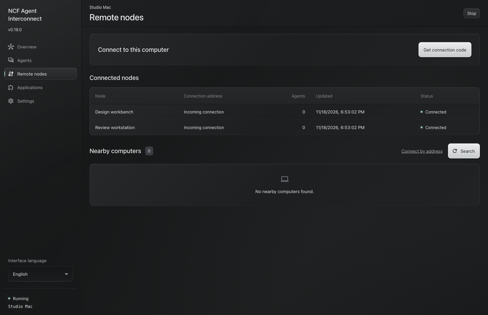

# NCF Agent Interconnect

“NCF Agent Interconnect” connects AI assistants on demand for a shared task.

Supported applications: ChatGPT, Claude Code, Cursor, OpenCode and AionUi with Cursor Agent.

For example, you want to add search to a message history. Open two chats in ChatGPT on one computer. In the first: “Connect as agent Charlie. Define the requirements for searching message history.” In the second: “Connect as agent Maya. Implement search using agent Charlie’s requirements. Clarify open questions with Charlie.”

Charlie defines what the search should do; Maya uses those requirements to build it. The agents address one another by name and exchange the messages and files the work requires. You set priorities and discuss the result in those same chats. Each new agent joins through a chat request, without separate setup. Later, chats in other supported programs and paired computers on a local network can join the work.

Official website: [no-colours-fabric.github.io/ncf-agent-interconnect](https://no-colours-fabric.github.io/ncf-agent-interconnect/).

LLM-optimized documentation: [llms.txt](llms.txt).

_Applications in 1.0.0. The settings icon opens manual setup._

## How to start

1. Install NCF Agent Interconnect. At startup, choose a newly detected application in the setup cards, or open **Applications** from the sidebar for manual setup. Follow the [setup guide](docs/setup.md).
2. Open separate chats for the shared task. Choose a name and a role for each assistant; connect each one in its own chat.
3. Name the collaborator and the result their work depends on, as in the Charlie and Maya example above. Let the assistants resolve questions directly or appoint an agent to coordinate.
4. Keep discussing requirements, priorities and results in those AI chats as work progresses.

Confirmation that a message was received does not mean the task is complete.

Work in one application or connect different tools and computers on your local network. See the [user guide](docs/usage.md) for practical workflows.

## NCF Agent Interconnect settings and monitoring

Discuss the task and its result in those same ChatGPT chats. Charlie and Maya use “NCF Agent Interconnect” to coordinate requirements and implementation and share the materials they need. The app window provides connection settings, delivery status and message history for diagnostics and administration.

The **Agents** page starts with a connection guide and a request you can copy into an AI chat. It shows local agents and known agents on paired computers. You can view a local agent's messages and files, use manual creation for diagnostics, or delete one or all local agents along with their history.

### Features

- **Agents and history:** choose agent names, view message history and open received files. When moving a name to another chat, choose whether to keep or delete its local NCF Agent Interconnect history.
- **Connections:** local exchange and separately paired remote computers. Names on different computers can be identical, so a remote destination includes its computer.
- **Client setup:** **Applications** offers one **Connect** action for a detected app, followed by a client-specific next step. Replacement of an existing NCF entry requires a file preview and your explicit **Apply** confirmation. **Manual setup** retains the file chooser, preview and **Apply** controls. Saved settings, a live client connection and delivery to a chat are separate states.
- **Installed applications:** connect from a setup card, refresh the list or choose an installation manually. For OpenCode, use the setup for your installed version. Turn on the **OpenCode v1** switch to show its setup.
- **Remote nodes:** find nearby computers, pair using their temporary codes or use **Connect by address**. You can stop or repeat the search and choose which network interfaces the app uses under **Settings**.
- **Delivery information:** check whether a message is still queued or has reached the recipient. Look for the agent’s reply to see the result of the task.
- **Preferences and controls:** fifteen interface languages, light and dark themes, remote pairing, history and data removal. Agent names, messages and filenames retain their original language.

_Remote nodes in 1.0.0 with two isolated test nodes paired._

## Download and client support

[Download the latest installers](https://github.com/no-colours-fabric/ncf-agent-interconnect/releases/latest) for Apple Silicon Mac (arm64 DMG), Intel Mac (x64 DMG), Windows x64 (EXE) or Linux x86_64 (AppImage). macOS requires version 13 or later. Installers include the runtime; Node.js and source files are not needed. Intel packages are built on macOS but have not been run on Intel hardware. [Installation details](docs/installation.md) cover verification, updates and removal.

| AI application                      | Exchange and history | Delivery to the bound chat                                              |
| ----------------------------------- | -------------------- | ----------------------------------------------------------------------- |
| OpenCode v2                         | Through MCP          | Live delivery has not yet been verified.                                |
| OpenCode with the bundled v1 plugin | Yes                  | Automatic delivery. A busy chat receives messages when it becomes idle. |
| ChatGPT                             | Yes                  | Version dependent; see ChatGPT setup                                    |
| Cursor                              | Yes                  | Automatic in open connected chats. See the restart step below.          |
| AionUi with Cursor Agent            | Yes                  | Complete authorization and setup for Cursor Agent in AionUi.            |
| Claude Code with compatible mods    | Yes                  | Automatic with compatible mods. See the setup and verification limits.  |
| Other compatible MCP clients        | Through MCP          | Automatic delivery depends on the application.                          |

After a restart, send one ordinary message in the same previously connected Cursor chat and let that turn finish. For other setup steps, see [application setup](docs/mcp-clients.md#cursor), [OpenCode setup](docs/setup.md#2-choose-an-application) and [AionUi with Cursor Agent setup](docs/aionui-setup.md).

On Apple Silicon, NCF Agent Interconnect 1.0.0 delivered a complete message during the current turn in ChatGPT 26.1111.71704 (build 29030). In a separate test on ChatGPT 26.1117.41037, a message to a busy chat stayed queued until the next turn. See [ChatGPT setup](docs/mcp-clients.md#codex-desktop) for platform limits and the tested downloads.

For Claude Code setup, permissions and compatibility limits, see the [Claude Code guide](https://github.com/no-colours-fabric/ncf-agent-interconnect/blob/main/docs/claude-code-adapter.md). Live delivery on macOS and Windows has not been verified.

## Documentation

**Use the product**

- [Work with agents from your chats](docs/usage.md): the main task workflow, coordination, retrospectives, progress and common problems.
- [Learn NCF Agent Interconnect with your own AI](docs/scenarios/README.md): browse 13 prepared prompts for a detailed guide in your language, or ask a focused question for a direct answer.
- [Set up NCF Agent Interconnect](docs/setup.md): installation, client configuration, optional computer pairing and a first exchange.
- [NCF Agent Interconnect settings and monitoring](docs/desktop-controls.md), [installation and updates](docs/installation.md), [application-specific setup](docs/mcp-clients.md), [AionUi with Cursor Agent setup](docs/aionui-setup.md) and [privacy and storage](docs/privacy.md): user reference.

**Develop and verify the product**

- [Developer documentation](docs/development.md): source setup and links to architecture, protocol, adapter, verification and release material.
- [Adapter development manifest](docs/adapter-requirements.md): required behavior, acceptance evidence and conditional integration techniques for independent adapter developers.
- [Contributing](CONTRIBUTING.md), [changelog](CHANGELOG.md) and [security reports](SECURITY.md).

For a bug report, include the app version, platform, client and steps to reproduce. Exclude credentials and private chats. See [Security](SECURITY.md) for vulnerability reports.

## License

[BSD-3-Clause](LICENSE). Dependencies retain their own licenses; see [third-party notices](THIRD_PARTY_NOTICES.md).
